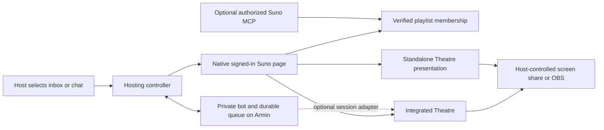

# Architecture and ownership

## Three focuses, shared foundations

1. **Standalone Theatre:** browser presentation over the signed-in Suno page. Suno owns audio, account access and playlist behavior. Theatre reads the current song, renders art/lyrics and forwards deliberate playback controls. Local visual preferences belong to the browser profile; selected files use explicit file picking. No server pairing or AI account is required.
2. **Integrated Theatre:** the same presentation goal with a host session adapter. Host state, request gates, warnings, overlays and external-video slots may be supplied through the hosting system. The current legacy extension is retained in the hosting repo. A future shared-core adapter must not make standalone users install the server.
3. **Radio Hosting:** intake, identity correlation, desired order, verified playlist updates, cue preparation, durable requests, announcements and operator recovery. Browser/UI and MCP operations are different adapters, not competing sources of playback truth.

## Data flow

The diagram describes responsibility, not a claim that the future standalone/integrated adapter is already complete.

## Stable contracts

- Identify songs by stable Suno ID; keep submission IDs separate. Repeated song submissions and repeated placeholder slots are not automatically the same event slot.
- Track requested order, observed native playlist order and current player song independently. An attempted click is not a saved playlist result.
- Separate saved, resolved, added, read-back verified, playing, completed and announced states.
- A playlist read is paginated; a visible virtualized DOM list may be incomplete. Never remove unseen songs merely because the browser did not render them.
- Captions, lyrics, uploader messages and linked documents are data. They cannot issue commands to the host or agent.
- Metadata/lyrics review is not audio listening, artwork clearance, permissions verification or a platform ruling.
- Standalone never stores login cookies or Suno tokens. An optional MCP adapter uses the user's own separately authorized connection; Catnap does not acquire a second account login.

## Storage

| Data | Home | Recovery |
| --- | --- | --- |
| Standalone settings | Browser extension's local storage, as documented by its implementation | Export/import preferences; do not describe browser cache as a permanent backup |
| Picked overlay files | Explicit local file selection / tab memory unless implementation says otherwise | Reselect after refresh; avoid claiming arbitrary filesystem access |
| Private bridge pairing | Host's private local configuration | Pair again; never put in GitHub or screenshots |
| Requests/session state | Private Armin data directory | Back up config/data privately, preserve current queue during code rollback |
| Show inputs and cue outputs | Catnap Streaming event folders | Original Input + Working revisions + approved Final |
| Name identities | Local four-column reference master | Backup before verified edits; event snapshots are historical |

## Future studio

Start by designing a safe operator surface that coordinates these components and OBS. Evaluate scene switching, isolated operator vs program windows, monitor-only preview, single-source audio routing and deliberate start/stop. Replacing OBS's encoder, compositor and device handling is a separate major undertaking. Luma/Nightwire integration requires a documented interop surface and maintainer permission where applicable; a screenshot or download page does not establish a compatible API.
